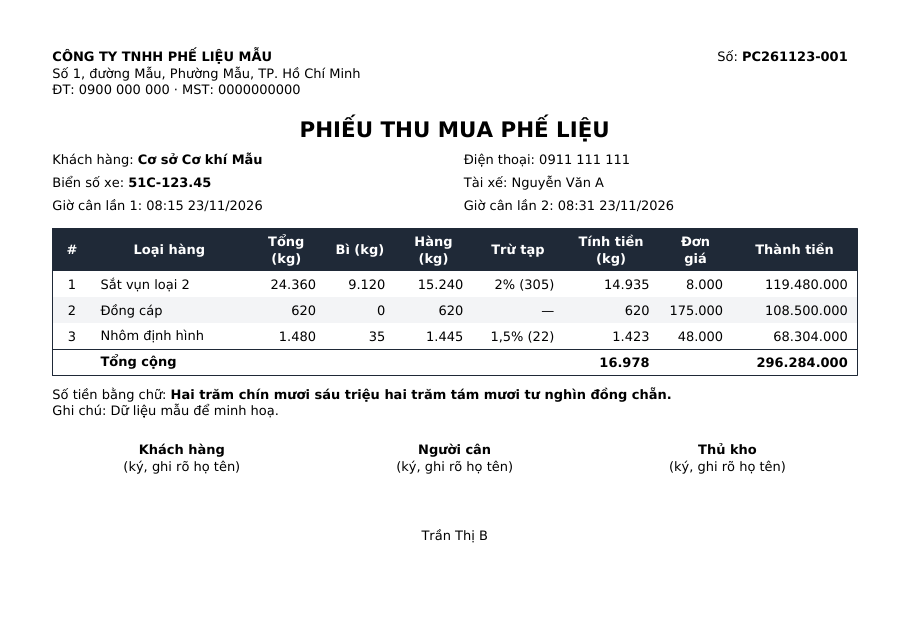
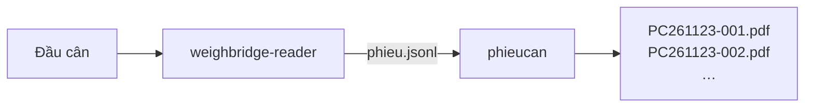

# phieu-can-generator

[](https://github.com/ferbdev-byte/phieu-can-generator/actions/workflows/ci.yml)


Xuất **phiếu cân** và **phiếu thu mua phế liệu** ra PDF tiếng Việt, sẵn để in khổ A5. Công cụ tự tính khối lượng hàng (tổng − bì), trừ tạp chất, thành tiền, và **đọc số tiền bằng chữ** đúng quy tắc tiếng Việt.



<sub>Phiếu trên dùng dữ liệu mẫu ([examples/phieu-mau.json](examples/phieu-mau.json)) · [Xem bản PDF](docs/phieu-mau.pdf)</sub>

## Tính năng

- **PDF khổ A5 ngang**: đủ dấu tiếng Việt (nhúng sẵn font DejaVu Sans), có bảng nhiều dòng hàng, ô ký cho khách hàng, người cân và thủ kho.
- **Tự tính toán**: hàng = tổng − bì, trừ tạp chất theo %, khối lượng tính tiền, thành tiền và tổng cộng. Nhập ngược tổng và bì cũng tự đảo lại cho đúng.
- **Đọc số tiền bằng chữ** có bộ test riêng: *lẻ*, *mốt*, *lăm*, *tư*, *mươi*, *không trăm*, tới hàng nghìn tỷ.
  `296.284.000` → *Hai trăm chín mươi sáu triệu hai trăm tám mươi tư nghìn đồng chẵn.*
- **In cả lô**: đọc file JSON Lines do [weighbridge-reader](https://github.com/ferbdev-byte/weighbridge-reader) ghi ra từ đầu cân, mỗi xe một phiếu, số phiếu tự sinh.



## Cài đặt

```powershell
pip install git+https://github.com/ferbdev-byte/phieu-can-generator
```

## Dùng

```powershell
# Một phiếu từ file JSON
phieucan examples/phieu-mau.json -c examples/cong-ty.json -o phieu

# Cả lô từ đầu cân, đổi tiêu đề phiếu
phieucan phieu-can.jsonl -c cong-ty.json -o phieu --kind "PHIẾU THU MUA PHẾ LIỆU" --prefix TM

# In khổ A4 dọc cho máy in văn phòng (mặc định là A5 ngang)
phieucan examples/phieu-mau.json -c examples/cong-ty.json --a4
```

Định dạng một phiếu (xem đầy đủ trong [examples/phieu-mau.json](examples/phieu-mau.json)):

```json
{
  "partner": "Cơ sở Cơ khí Mẫu",
  "plate": "51C-123.45",
  "lines": [
    {"material": "Sắt vụn loại 2", "gross_kg": 24360, "tare_kg": 9120, "impurity_pct": 2, "unit_price": 8000}
  ]
}
```

## Dùng như thư viện

```python
from phieucan import Company, Line, Slip, render_pdf, so_tien_bang_chu

slip = Slip("PC-001", partner="Khách lẻ", plate="51C-123.45",
            lines=[Line("Đồng cáp", 620, 0, unit_price=175_000)])
render_pdf(slip, Company("CÔNG TY CỦA BẠN", phone="0900 000 000"), "PC-001.pdf")
so_tien_bang_chu(108_500_000)  # 'Một trăm lẻ tám triệu năm trăm nghìn đồng chẵn.'
```

## Phát triển

```powershell
pip install -e ".[dev]"
ruff check .
pytest
```

Test kiểm tra cách đọc số, các phép tính trên phiếu, và cả **nội dung chữ trong PDF xuất ra** (bằng pypdf).

## Giấy phép

MIT. Font DejaVu Sans đi kèm dùng giấy phép riêng của nó, xem [src/phieucan/LICENSE-DejaVu.txt](src/phieucan/LICENSE-DejaVu.txt).
